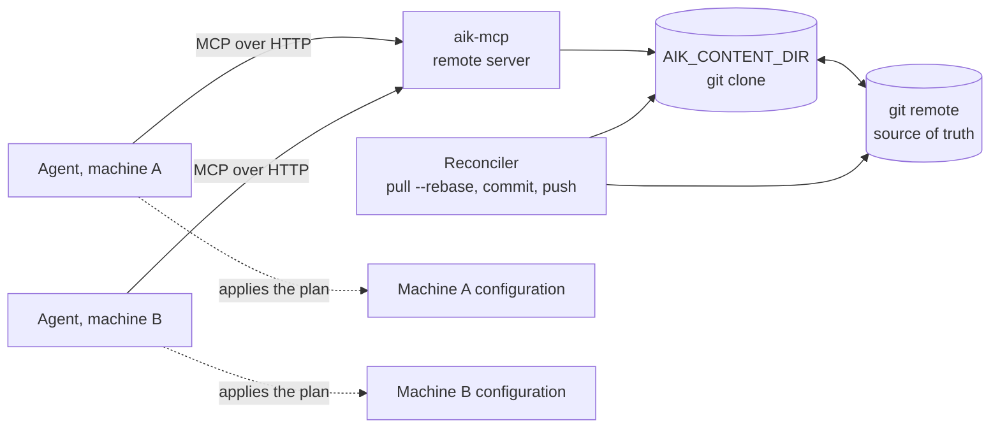

# Running aik-mcp as a Remote Server

One server and one knowledge base for several machines and agents. This page
covers what changes when the server does not run on the machine it serves: how a
session works, how an installation happens when the target machine is elsewhere,
and how the content stays in sync.

## When to run it remotely

Run the server over HTTP when the knowledge base has to be shared: several
workstations, several agents, or a team. The alternative, one stdio server per
machine, is simpler and writes installations itself, but every machine then needs
its own copy of the content and of the server runtime.

The two transports differ on one point only, the installation family. Everything
else is identical. Over stdio the server runs where the content is installed, so
it writes the files. Over HTTP it runs elsewhere, so it returns a **plan** the
client applies on its own machine.

## How the pieces fit



- **Client agents** speak MCP over HTTP, with a bearer token.
- **The server** reads the content store from `AIK_CONTENT_DIR`. Any directory
  works; a git clone is the recommended shape, because it gives you history,
  review and a second writer path.
- **The reconciler** is optional and is not part of aik-mcp: it is whatever keeps
  the clone and the git remote in step when the MCP itself writes. A short loop
  (pull, commit, push) is enough, and any tool doing that will do.
- **Workstations** are ordinary clones of the same repository: pull to read,
  commit and push to write.

## Transport and authentication

```bash
MCP_API_KEY="$(openssl rand -hex 32)" AIK_CONTENT_DIR=/srv/aik-content \
  npx aik-mcp --http --port 3456
```

The HTTP transport is **fail closed**: it refuses to start without a real
`MCP_API_KEY` (empty, or the `change-me` placeholder, is rejected). `/health` is
the only public route, and every other request needs
`Authorization: Bearer <key>`. Terminate TLS in front of it (a reverse proxy) and
keep the key in the client's environment, never in a committed file.

## Sessions

Over HTTP the server opens one MCP session per connection, and one server
instance per session. Each session:

1. starts with `initialize`;
2. receives the bundled instructions in the `initialize` result. Those
   instructions carry the plan contract (`aik-knowledge-content`, versioned);
3. lists the tools: 10 over HTTP, 14 over stdio.

Two consequences, both routine:

- **A deployed server invalidates live sessions.** A new container, a restart, a
  new image: the next request on an old session fails with
  `initialization required` (HTTP 400). Clients reconnect on their own, or with
  `opencode api experimental.mcp.disconnect --param server=aik` then `connect`.
- **Tool schemas are cached by the client.** After a deployment, reconnect
  before trusting the tool list: a client that kept the previous catalogue calls
  tools that no longer exist, or misses the new ones.

## Installation over HTTP: the plan

An MCP server executes its tools where it runs. With the server on another host,
a tool that resolves `process.cwd()` or `homedir()` describes _that_ host: the
write lands in the server container and the call reports success anyway. The
write has to happen where the agent is, so the server plans it.

`aik_install` and `aik_uninstall` return a plan:

```jsonc
{
  "planVersion": 1,
  "operation": "install",
  "item": {
    "path": "rules/typescript",
    "name": "typescript",
    "category": "rules",
    "version": "1.2.0",
  },
  "agent": "claude-code",
  "scope": "project",
  "base": {
    "kind": "project",
    "hint": "the project root (current working directory of the agent)",
  },
  "actions": [
    {
      "op": "write_file",
      "path": ".claude/rules/typescript.md",
      "content": "---\\n…",
      "sha256": "6f1c…",
    },
  ],
  "warnings": [],
  "summary": "install rules/typescript for claude-code (project): 1 action(s) to apply",
}
```

`base` names a directory declaratively, never an absolute path of the server:

| `kind`         | Meaning                                                                           |
| -------------- | --------------------------------------------------------------------------------- |
| `project`      | the root of the workspace the agent works in                                      |
| `agent-global` | a hint to resolve on the client, such as `~/.claude` or `$CODEX_HOME or ~/.codex` |

Every path in the plan is relative to that base, and every file the plan asks for
carries its sha256. The operations are the whole vocabulary:

| Operation             | What it does                                                                                                |
| --------------------- | ----------------------------------------------------------------------------------------------------------- |
| `write_file`          | write `content` to `path`, replacing it                                                                     |
| `install_skill`       | create `dir`, write `skillMd` in it, then each asset (`base64` decoded, or `utf8` as is); skip if it exists |
| `section_upsert`      | append a `##` section to a shared file, unless the heading already opens on the marker                      |
| `section_remove`      | remove that section, up to the next heading that opens on a marker, or the end of the file                  |
| `delete_file`         | delete `path` (missing file: nothing to do)                                                                 |
| `delete_dir`          | delete `dir` and its content (missing directory: nothing to do)                                             |
| `config_entry_add`    | add an entry to a string array of a JSON config file                                                        |
| `config_entry_remove` | remove that entry                                                                                           |

The config entry value depends on the scope: relative to the project root in the
`project` scope, tilde-absolute in the `agent-global` scope, so a shared config
file never carries one machine's home directory.

### Applying a plan with the agent

The bundled instructions describe the procedure, and any agent able to write a
file can follow it: resolve the base, run the operations in order, check each
sha256 before writing, report the paths written. Nothing in the payload names an
agent or an aik-specific mechanism, which is what keeps the server agent-agnostic.

### Applying a plan with `aik-apply`

For scripts, and for payloads too large to pass through a model, the package ships
an applier. Same plan, byte-for-byte, no model in the loop:

```bash
curl -fsS -H "Authorization: Bearer $MCP_API_KEY" \
  "https://aik.example.com/plan/skills/generate-changelog?agent=codex&scope=project" \
  -o plan.json
aik-apply plan.json --base /path/to/project
aik-apply plan.json --dry-run   # resolve the base and verify, write nothing
```

`GET /plan/<item>?agent=<agent>&scope=<scope>&configPath=<path>` serves exactly
what `aik_install` returns, authenticated like `/mcp`. The command reads the plan
from a file or stdin, verifies every sha256 **before** writing, and exits non-zero
on a corrupt payload or an unknown operation.

### Gating on the client's project

An install can be gated by technology stack or by MCP servers the content
requires. The server cannot inspect the client's project, so the client may pass
what it knows:

```jsonc
{
  "path": "rules/typescript",
  "agent": "claude-code",
  "scope": "project",
  "projectInfo": { "stacks": ["typescript"], "mcpServers": ["joplin"] },
}
```

With no `projectInfo`, the gating only warns, it never blocks: an honest "I
cannot tell" beats a probe of the wrong machine.

### Updates: the client owns the inventory

`aik_check_updates` compares the knowledge base with what is installed. Over HTTP
the inventory comes from the client: read `aik_layout` for the paths, read the
`version` field of each installed file, and send the list.

```jsonc
{ "items": [{ "path": "rules/typescript", "version": "1.0.0" }] }
```

The answer lists the items with a newer version, the up-to-date ones, and the
ones the knowledge base does not know.

### Tools that only exist over stdio

`aik_reinstall`, `aik_update`, `aik_list_installed` and `aik_uninstall_all` are not
registered over HTTP, because each needs the installed state on the server's own
disk. They are compositions, done on the client side:

| Stdio tool           | Over HTTP                                                           |
| -------------------- | ------------------------------------------------------------------- |
| `aik_update`         | `aik_uninstall` then `aik_install`, applying both plans             |
| `aik_reinstall`      | the same pair, without checking versions first                      |
| `aik_list_installed` | the inventory described above (`aik_layout` + frontmatter versions) |
| `aik_uninstall_all`  | uninstall plans, one per installed item                             |

## Keeping the content in sync

Git is the source of truth; the server's directory is a clone of it.

- **Reads** are served from `AIK_CONTENT_DIR`, cached in memory. The server
  watches the directory root, so a `git pull` in the clone is visible within the
  second, with no restart and no reconnection.
- **Writes through MCP** (`aik_write`, `aik_delete`) land in the clone. Without a
  reconciler they stay local to the server; with one, they are committed (with a
  bot identity) and pushed at its next tick.
- **Writes from a workstation** are plain git: commit and push, then the clone
  catches up. That is also the review path.

A minimal reconciler loop, run from a cron, a timer or a sidecar:

```bash
cd "$AIK_CONTENT_DIR"
git pull --rebase --autostash
git add -A
git diff --cached --quiet || git commit -m "content: MCP writes"
git push
```

Installations no longer create server-side commits over HTTP, since the plan is
applied on the client. The reconciler still matters for `aik_write` and
`aik_delete`.

## Worked example

A full round trip, from an empty project to an installed rule and back.

```bash
export MCP_API_KEY=...           # the key the server was started with
URL=https://aik.example.com/mcp
AUTH="Authorization: Bearer $MCP_API_KEY"
JSON="Content-Type: application/json"
STREAM="Accept: application/json, text/event-stream"
```

```bash
# 1. Open a session and keep its id
curl -sS -D headers.txt -H "$AUTH" -H "$JSON" -H "$STREAM" "$URL" \
  -d '{"jsonrpc":"2.0","id":1,"method":"initialize","params":{"protocolVersion":"2025-03-26","capabilities":{},"clientInfo":{"name":"curl","version":"0"}}}'
SID=$(grep -i '^mcp-session-id:' headers.txt | tr -d '\r' | cut -d' ' -f2)
curl -sS -H "$AUTH" -H "$JSON" -H "$STREAM" -H "mcp-session-id: $SID" "$URL" \
  -d '{"jsonrpc":"2.0","method":"notifications/initialized"}'

# 2. Ask for a plan, then apply it
curl -fsS -H "$AUTH" "$URL/../plan/rules/typescript?agent=codex&scope=project" -o plan.json
aik-apply plan.json --base .
grep -c '<source>rules/typescript</source>' AGENTS.md

# 3. Uninstall: ask for the uninstall plan, apply it, the file is back to its initial state
curl -fsS -H "$AUTH" -H "$JSON" -H "$STREAM" -H "mcp-session-id: $SID" "$URL" \
  -d '{"jsonrpc":"2.0","id":2,"method":"tools/call","params":{"name":"uninstall","arguments":{"path":"rules/typescript","agent":"codex","scope":"project"}}}' \
  | sed -n 's/^data: //p' | jq -r '.result.content[0].text' > uninstall.json
aik-apply uninstall.json --base .
```

The round trip is byte-identical: the section delimitation is the same on both
sides, so an install followed by an uninstall restores the file as it was.

## Pitfalls

- **A session is bound to a server instance.** Deploying a new image breaks the
  live sessions: reconnect, and expect `initialization required` from a stale one.
- **The tool list depends on the transport.** 10 tools over HTTP, 14 over stdio.
  Compare with `tools/list` when a tool seems missing.
- **The plan is not a suggestion.** Applying half of it, or skipping the sha256,
  leaves a state neither the engine nor `aik_check_updates` can reason about.
- **`install_skill` does not upgrade in place.** An existing skill directory is
  skipped, like the direct engine: uninstall, then install.
- **`planVersion` guards the shape.** An applying agent or an `aik-apply` older
  than the plan fails on the unknown operation instead of guessing.

## See also

- [MCP Tools](tools.md): the mode-by-mode tool table.
- [Architecture](architecture.md): what the server does with the content.
- [ADR 0002](../adr/0002-installation-plans-for-remote-servers.md): why the
  installation family plans instead of writing.
